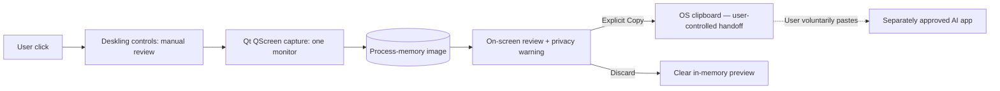

# ADR-004 — Explicit, Local Screen Review as the First Screen Assist Slice

**Status:** Proposed implementation in `feat/i1-user-invoked-screen-review`; not an approved enterprise monitoring or AI integration policy.  
**Date:** 2026-11-10  
**Related issue:** [#14](https://github.com/cdracars/Deskling/issues/14)  
**Baseline:** Deskling is a local X11-first Rust + Qt companion with no vision or provider connectors.

## Problem / opportunity

A desktop companion becomes more useful if a user can ask for help with a **specific visible task**: improve written wording, identify an error, explain an unfamiliar screen, or notice a missed workflow opportunity. Screen understanding can also expose sensitive documents, customers, credentials and communications. Deskling must not silently capture, transmit, retain or infer from a screen.

## Decision

Implement **manual screen review first**, behind a conspicuous user action in existing Deskling controls:

1. User intentionally clicks **Review this monitor…**.
2. Deskling temporarily hides its windows, captures its X11 monitor once and restores the companion.
3. Deskling displays an **in-memory** image preview, with a warning that the entire monitor may include private information.
4. User explicitly chooses **Copy screenshot to clipboard** or **Discard and close**. Discard clears Deskling's in-memory image reference. Copy writes to the desktop clipboard, which other applications may read; the user controls any later paste.
5. No screen analysis model, account, OCR, file persistence, HTTP upload, or continual capture is added. The user must choose their own **organization-approved** AI destination.

### Trust boundaries

There is deliberately **no Deskling-to-AI link** in this first slice. The dashed link is a user action outside Deskling, not an implemented connector. The existing runtime character pack stays inert JSON/PNG data; screen capture never executes pack content.

## Alternatives rejected for now

- **Continuous passive screen watching:** inappropriate privacy/consent model and unnecessary for validating user value.
- **Send screenshot automatically to a cloud model:** unapproved data destination, potential organizational confidentiality violations.
- **Automatic active-window clipping/OCR/redaction:** desirable, but platform, window manager and data handling uncertainties require separate spec/tests. A visible full-monitor warning is *not* an adequate replacement for redaction if enterprise deployment is proposed.
- **Full AI agent integration:** out of scope; no model SDK, local inferencer or provider approval exists.

## Security and usability acceptance

- Capture only follows an explicit click. A timer is allowed **only after** that click to let Deskling hide its own windows.
- Preview precedes clipboard transfer. There is no automatic clipboard write.
- A failed capture restores the companion and displays a recoverable error.
- Limit captured image size; no disk files or remote transfers.
- Smoke tests exercise the no-capture/no-copy path. Real Ubuntu/X11 desktop validation must check capture preview, sensitivity warning, discard and copy behavior, startup and failure recovery.
- Warn that other desktop apps may access clipboard images; clearing Deskling's preview **does not clear a previously copied clipboard image**.
- Do not claim the app has analyzed the image or made recommendations. It only enables user-directed sharing.

## Roadmap after prototype, requiring independent authorization

**Screen Intelligence v0.2:** user-selected window/region capture, visible redaction tools, app/window exclusion and a local/policy-compliant AI adapter; select one simple user problem (e.g. rewriting visible text). Produce structured suggestions with assumptions and explicit no-action default. Implement with strong provider isolation and opt-in only.

**Potential organization pilot:** sponsor must confirm targeted role/use, data classification, model provider policy, employee notice and retention, technical controls, support model and consent/opt-out. Do not equate an employee's ability to press a capture button with company authorization to send customer information to an arbitrary AI assistant.

## Evidence and limitations

CI can verify C++/QML compilation, smoke-mode restrictions and basic source contracts, **not** real captured-window composition or user comprehension. The next independent verification step is a recorded X11 session with non-sensitive mock content. Do not claim actual screen intelligence, approved workplace use or distribution readiness from a successful build.
