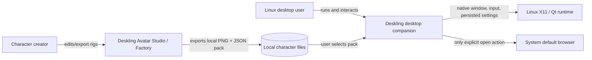
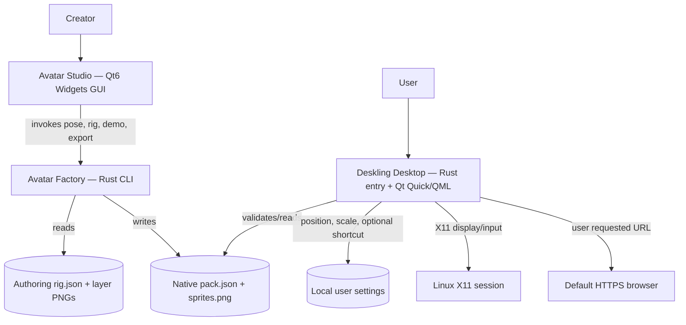
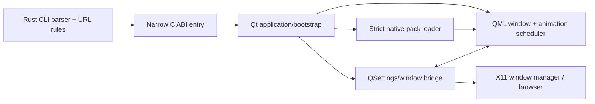

# Deskling C4 Architecture — Current and Proposed

**Status:** Repository-backed baseline with forward-looking decisions explicitly marked.  
**Code baseline:** `main` `b41ff3daf29967fa0b35b290f6d9ae1218393ec6`.  
**Model:** [C4 architecture](https://c4model.com/introduction): Context, Container, Component, Code. Containers in C4 mean applications/data stores, **not Docker**.

## Level 1 — System context (current)

**System boundary:** the local desktop program, local authoring programs and inert local character assets. No account server, background monitoring, model, cloud service or integration adapter is implemented.

## Level 2 — Containers (current)

These are local programs and files, not network microservices. The **Factory** uses system zlib for PNG handling; the **desktop** dynamically links Qt. The editor is authoring-only; it does not need to remain open for runtime animation.

## Level 3 — Desktop runtime components (current)

**Data boundary:** `--pack` is supplied explicitly. The loader validates the local manifest and PNG; pack content does not reach the Rust CLI as an executable instruction. QML owns decorative scheduling; the bridge owns native UI/settings behavior and the optional browser action.

## Level 4 — Code and concrete evidence

| Architectural responsibility | Verified repository location |
| --- | --- |
| CLI, URL parsing, core Rust rules | [`crates/deskling-core/src/lib.rs`](../crates/deskling-core/src/lib.rs) |
| Desktop Rust entry, C ABI invocation | [`crates/deskling-desktop/src/main.rs`](../crates/deskling-desktop/src/main.rs) |
| Qt boot, native bridge, local state and smoke capture | [`crates/deskling-desktop/native/bridge.cpp`](../crates/deskling-desktop/native/bridge.cpp) |
| Manifest validation / image loading | [`crates/deskling-desktop/native/pack.cpp`](../crates/deskling-desktop/native/pack.cpp) |
| Animation state, interactions, controls | [`crates/deskling-desktop/qml/Main.qml`](../crates/deskling-desktop/qml/Main.qml) |
| Rust rig/export/PNG CLI | [`tools/avatar-factory/`](../tools/avatar-factory/) |
| Qt visual editor + authoring model | [`tools/avatar-studio/`](../tools/avatar-studio/) |
| Automation and native smoke verification | [`scripts/verify.sh`](../scripts/verify.sh) and [CI](../.github/workflows/ci.yml) |

No invented classes/services are required to tell the current code story. A deep code diagram is not warranted until a component is complex enough to justify it.

## Proposed changes — Iterations 1 and 2, **not current state**

1. **First-run experience / selected pack path:** an explicit character choice with persisted local reference and a safe fallback when a selected pack is missing or invalid. Keep CLI `--pack` authoritative for one-off tests. Decide whether the chosen art is distributable before bundling it.
2. **Consistent demo install/launch:** separate an isolated test kit from a later release package. No install/autostart by default. Document supported Ubuntu/X11 and Qt dependencies.
3. **Authoring-to-runtime feedback:** help creators find visual defects and run exported packs; do not replace native loader contract with a novel format without ADR.
4. **Optional future integrations:** if justified by the sponsor, add an explicit permissioned adapter/port outside the character pack and animation scheduler. **No connector is authorized or implemented in this iteration.**

## Trust boundaries and architectural risks

- Local pack input is untrusted data. Continue strict local-only paths, manifest schema limits, PNG validation and resource caps. Avoid live code/plugin execution inside a pack.
- The native renderer and Qt image stack are not OS sandboxes. An invalid file must fail closed rather than fall through to a dangerous path.
- `QSettings` currently persists link, scale and position. Proposed selected-pack persistence needs validation against missing/symlink/changed files and clear behavior for personal data exposure in error messages.
- Real X11 transparency, stacking, keyboard focus, dragging and smoothness are **not proven** by offscreen CI. Capture a real desktop test and environment details.
- Character assets have separate licensing from MIT application code. Record rights before distribution.
- Pack format schema 1 is the current compatibility boundary; preserve loader behavior and regression fixtures.

## Architecture decisions pending

**ADR-001:** First-run character selection and fallback strategy.  
**ADR-002:** Supported distribution/test-kit approach and uninstall contract.  
**ADR-003 (defer):** Whether adapters exist at all, based on product evidence and explicit permission boundaries.

Do not represent these proposals as implemented. See [constitution](PRODUCT_CONSTITUTION.md) and [iteration plan](ITERATION_PLAN.md).
